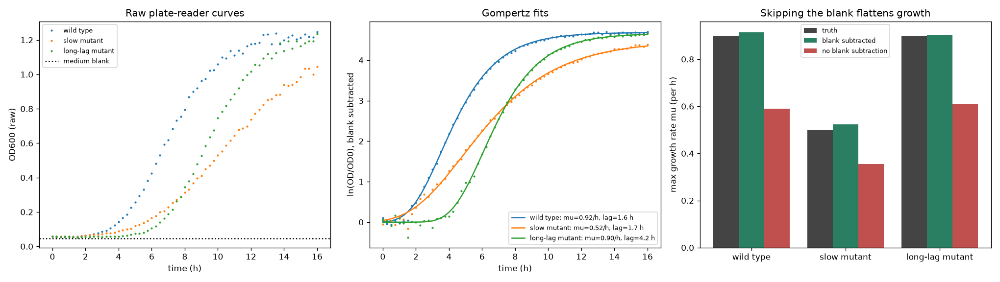

# Bacterial Growth Curve Fitting

> Your mutant doesn't grow slower. You forgot to subtract the blank.

## Demo Output



Produced from simulated plate-reader data by `demo.py`: raw OD curves for three strains, Gompertz fits on blank-corrected log OD, and growth rates with and without blank subtraction.

## Why This Exists

Growth curves look trivial: the curve goes up, you compare strains. But "growth rate" only means something on a log scale, after the medium's own absorbance has been removed, measured where growth is actually exponential. This repo does both standard analyses, a model-free maximum slope and a Gompertz fit, and shows how a missing blank alone can produce a "phenotype".

## What You Get

| Parameter | Meaning | Estimated by |
|-----------|---------|--------------|
| mu (per h) | Maximum specific growth rate | Steepest sliding-window slope of ln(OD), or Gompertz |
| lag (h) | Time before exponential growth | Where the max-slope tangent crosses the starting level |
| doubling time | ln(2) / mu | Derived from mu |
| A | Maximum ln(OD/OD0) (yield) | Gompertz asymptote |

```python
from growth import fit_gompertz, max_slope
fit_gompertz(time_h, od600, blank=0.045)
```

## When NOT to Use This

- **Diauxic growth** (two growth phases). A single sigmoid model hides the second phase. Fit each phase separately.
- **OD above about 0.6-0.8 in a plate reader.** The OD-to-cell-density relationship stops being linear, so calibrate or dilute.
- **Biofilm formers or clumping strains.** OD isn't measuring what you think.

## The Uncomfortable Truth

A blank of 0.045 is small next to an OD of 1, but large next to an OD of 0.01, and early growth is exactly where the growth rate is measured. Subtract the blank, and run the blank on the same plate.

## Further Reading

- Zwietering M. H. et al. "Modeling of the bacterial growth curve." Applied and Environmental Microbiology (1990).
- Sprouffske K. & Wagner A. "Growthcurver: an R package for obtaining interpretable metrics from microbial growth curves." BMC Bioinformatics (2016).
- Monod J. "The growth of bacterial cultures." Annual Review of Microbiology (1949).
